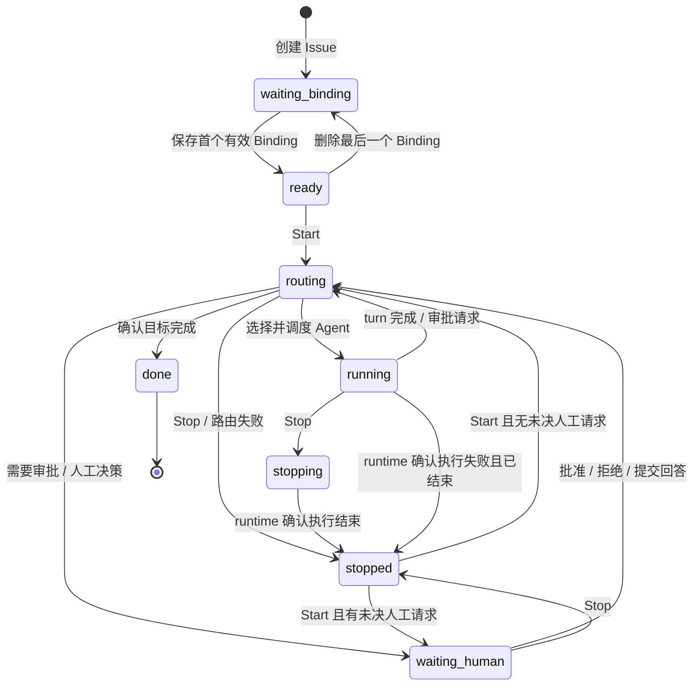

# Catcoon 产品定义

## 1. 目标与范围

Catcoon 是以 Issue 为中心的 Agent 协作系统。Human 描述目标、绑定 Agent 并启动工作；Agent 执行任务；Jev 根据执行结果判断下一步应交给哪个 Agent、等待 Human 决策，或结束 Issue。

每一版都必须交付可以实际运行的 happy path。第一版实现创建 Issue → 绑定 Agent → Start → Agent 执行 → Jev 判断 → Agent 接力或 Human 决策 → 完成，以及随时 Stop 的闭环。本次文档只定义产品行为和状态机，不实施系统代码。

第一版范围：

- 创建 Issue，填写标题和描述，两项均必填且不能仅包含空白。
- 绑定一个或多个 Agent，每个绑定必须描述该 Agent 在当前 Issue 中的功能和职责。
- 支持 `codex` 和 `pi` 两种 `agent_runtime`，两者均须能够实际执行任务。
- 显式 Start 后才开始自动流转；Stop 停止自动流转并请求中断当前执行。
- Jev 根据绑定职责、Issue 上下文和 Agent 结果进行路由。
- Human 能查看执行结果、处理审批和补充决策。
- 展示状态、当前执行 Agent、会话及活动历史。

第一版采用单 Issue 串行执行，同一 Issue 同时最多有一个执行中的 Agent turn。可只绑定 Codex 或 Pi，也可同时绑定二者；不强制二者都参与每个 Issue。

暂不包含其他 runtime（包括设计示例中的 Kimi）、并行 Agent、可视化工作流编排、复杂权限体系、自动重试策略、完成后重新打开，以及附件和外部产物平台集成。设计中的 checklist 不作为第一版创建或完成的必备条件，完成依据为描述中的目标与实际结果。

## 2. 角色与概念

| 概念 | 职责 |
| --- | --- |
| Human | 创建目标，定义绑定职责，Start / Stop，审批、拒绝或补充决策 |
| Agent | 按分配任务执行，返回答案、结果或审批请求 |
| agent_runtime | Agent 的执行适配层；第一版为 codex、pi，提供会话、执行、中断和事件转换 |
| Jev | TypeSafe AI 的结构化判断模型，用于判定下一步和选择 Agent |
| Orchestrator | 汇集上下文、调用 Jev、校验决策，并依据状态机调度 runtime |
| Binding | 某个 Issue 与 Agent 的关联，包含 runtime 和该 Issue 下的功能描述 |
| Session | 绑定 Agent 的会话上下文，可供后续 turn 继续使用 |
| Turn | 一次分配给 Agent 的执行；一次回答完成不等于整个 Issue 完成 |
| Human request | 一项待人工处理的审批或问题，包含具体对象、上下文和处理结果 |

Agent 的功能由绑定内容决定。例如 Codex 可以负责实现，Pi 可以负责审查；这是配置示例，不是 runtime 的固定分工。Jev 只能选择已绑定、可用且职责匹配的 Agent。

## 3. 核心操作

### 3.1 创建和绑定

1. Human 填写标题、描述并创建 Issue。
2. 创建后进入 `waiting_binding`，不调用 Jev，不启动 Agent。
3. Human 添加 Binding，选择 runtime 并填写功能描述，例如“实现后端接口并运行验证”。
4. 至少一个有效 Binding 保存后进入 `ready`，仍不执行。
5. Human 点击 Start 后进入自动流转。

有效 Binding 指 runtime 类型受支持、功能描述非空且执行配置完整；runtime 是否在线在执行前检查。绑定不要求先创建会话；会话可以在首次执行时创建。

第一版只在 `waiting_binding`、`ready`、`stopped` 中允许编辑标题、描述及绑定。删除最后一个 Binding 时，未启动的 Issue 回到 `waiting_binding`；已停止的 Issue 保持 `stopped`，再次 Start 时要求补齐 Binding。

### 3.2 Start

Start 表示授权系统按当前目标和绑定职责自动推进，不等于人工批准某个具体请求。

- `ready`：进入 `routing`，由 Jev 判断首个任务的执行者。
- `stopped`：检查有效 Binding、旧 turn 已终止以及未决 Human request；有未决请求则进入 `waiting_human`，否则进入 `routing`。
- `waiting_binding`：禁止 Start，提示先绑定 Agent。
- `routing`、`running`、`waiting_human`、`stopping`、`done`：禁止重复 Start。

恢复会沿用已有结果和会话上下文，不从头重做，也不隐式重放被中断的工具操作；需要重新执行的工作必须形成新的 turn。

### 3.3 Agent 执行和 Jev 路由

1. Orchestrator 提供 Issue、绑定职责、历史结果、人工决策及本轮输入。
2. Jev 选择下一步；若选择 Agent，Orchestrator 校验 Binding 后创建 turn 并调度 runtime。
3. 执行中展示当前 Agent 和增量消息。文本流结束或工具执行结束不自动视为 turn 完成。
4. runtime 明确报告 turn 完成后，进入 `routing`，由 Jev 判断继续、换 Agent、交给 Human 或完成 Issue。
5. 若 runtime 报告需要审批，先挂起受审批约束的动作，再进入 `routing` 归并审批上下文；此时路由必须进入 `waiting_human`。

Agent 可以被连续选中，也可以接力。例如 Codex 完成实现 → Jev 选择 Pi 审查 → Pi 要求修改 → Jev 选择 Codex 修订 → Jev 判断完成。

### 3.4 Human 决策

`waiting_human` 有两种请求类型：

- `approval`：展示待批准的操作或产物、请求 Agent、版本或内容快照；支持 Approve 和 Reject。Reject 必须填写反馈。
- `input`：展示需要 Human 决定的问题与相关结果；Human 提交回答。

Human 提交后进入 `routing`。批准仅对指定请求及指定内容有效，Jev 可以将批准结果路由给原 Agent 继续执行；拒绝后不得执行原被拒绝操作，Jev 根据反馈安排修订或再次询问。回答也不直接指定 Issue 已完成，仍由 Jev 判断下一步。

处于 `waiting_human` 时不得调度新的 Agent turn。普通评论不能代替审批或明确回答。第一版同一 Issue 同时最多有一个未决 Human request。

### 3.5 Stop

Stop 表示停止当前 Issue 的自动推进，保留绑定、会话、输出和历史，不撤销已产生的文件修改或外部效果。

- `routing` 或 `waiting_human`：关闭自动流转，进入 `stopped`；在途 Jev 响应不得触发后续执行。
- `running`：立即关闭自动流转并进入 `stopping`，请求 runtime 中断当前 turn；确认结束后进入 `stopped`。
- `stopping`：重复 Stop 无副作用。中断尚未确认时保持该状态并展示原因，不得允许 Start 或伪装成已停止。
- `waiting_binding`、`ready`、`stopped`、`done`：Stop 不可用。

Stop 优先于尚未提交的路由或完成决策；已提交的 `done` 不再接受 Stop。停止后到达的旧消息可保留用于历史，但不得改变当前状态或继续派发任务。未决审批保留，停止期间不可提交；Start 后重新展示，避免批准动作隐式恢复运行。

## 4. Issue 状态定义

Issue 状态是业务状态的唯一来源。当前 Agent、turn 状态和列表筛选均从它及关联记录派生，不使用多个相互独立的运行开关表达同一事实。

| 状态值 | 展示名称 | 含义 | 是否自动推进 | 可用的主要操作 |
| --- | --- | --- | --- | --- |
| `waiting_binding` | 等待绑定 | 已创建，尚无有效 Binding | 否 | 编辑、绑定 |
| `ready` | 待启动 | 至少一个有效 Binding，尚未 Start | 否 | 编辑、调整绑定、Start |
| `routing` | 判断中 | 自动流转已开启，正在校验上下文或等待 Jev 决策 | 是 | Stop |
| `running` | 执行中 | 一个 Agent turn 正在执行 | 是 | 查看会话、Stop |
| `waiting_human` | 等待人工 | 有一项审批或决策需要 Human 处理 | 否；提交后恢复 | Approve / Reject / 回答、Stop |
| `stopping` | 停止中 | 已关闭自动流转，等待 runtime 确认中断 | 否 | 查看中断进度 |
| `stopped` | 已停止 | 无执行中的 turn，自动流转关闭，可保留未决请求 | 否 | 编辑、调整绑定、Start |
| `done` | 已完成 | Jev 判断目标已满足，且不存在未决请求或执行 | 否 | 查看结果和历史 |

第一版唯一的终态为 `done`。`stopped` 可恢复，不表示失败或完成。执行失败的最小处理规则见第 7 节。

### 4.1 状态机

### 4.2 转移条件与副作用

| 当前状态 | 事件 | 条件 | 下一状态 | 必须执行的副作用 |
| --- | --- | --- | --- | --- |
| 无 | 创建 | 标题、描述有效 | `waiting_binding` | 保存 Issue 并记录创建事件 |
| `waiting_binding` | 绑定 | 首个有效 Binding 保存成功 | `ready` | 保存职责，记录绑定事件 |
| `ready` | 移除绑定 | 已无有效 Binding | `waiting_binding` | 记录变更 |
| `ready` / `stopped` | Start | 有效 Binding，旧执行已结束，无未决请求 | `routing` | 创建新的运行代次，记录启动 / 恢复 |
| `stopped` | Start | 有效 Binding，旧执行已结束，有未决请求 | `waiting_human` | 创建新的运行代次，恢复人工请求入口 |
| `routing` | Jev 选择 Agent | 当前代次有效，绑定可用，无未决人工请求 | `running` | 创建 turn，传递任务与上下文，调度 runtime |
| `running` | turn 完成 | 当前 turn 的明确完成事件 | `routing` | 保存结果，清除当前执行引用，触发判断 |
| `running` | 需要审批 | 当前 turn 的审批事件，受审批动作已挂起 | `routing` | 保存请求和恢复引用；本轮执行不再推进 |
| `routing` | Jev 选择 Human | 有具体问题或审批对象 | `waiting_human` | 保存或关联 Human request，展示入口 |
| `waiting_human` | Human 提交 | 请求仍未决，内容版本匹配 | `routing` | 持久化决策，关闭请求，触发判断 |
| `routing` | Jev 判断完成 | 目标已满足，无未决请求，无运行中 turn | `done` | 保存完成摘要，记录完成时间 |
| `routing` / `waiting_human` | Stop | 当前状态仍匹配 | `stopped` | 撤销当前代次的派发资格，保留上下文 |
| `running` | Stop | 当前 turn 尚在执行 | `stopping` | 撤销派发资格，向 runtime 请求中断 |
| `stopping` | 结束确认 | 当前 turn 已完成或已中断 | `stopped` | 保存最终执行记录，清除当前执行引用 |
| `routing` / `running` | 执行错误 | 路由已终止或 runtime 确认执行已结束 | `stopped` | 保存错误原因，提示人工检查后 Start |

除表中定义的边外，不允许状态转移。重复点击、重复 runtime 事件和重复人工提交必须幂等；旧代次、旧 turn 的事件不得推动当前状态。派发任务前必须再次核对状态及代次，防止 Stop 与 Jev 返回并发时继续执行。

审批挂起期间，旧 turn 不能继续执行工具。后续批准的恢复执行仍受单 turn 约束，由 runtime 适配层关联原审批和会话；Issue 的 `running` 只表示执行正在推进，不包括挂起等待人工的会话。

## 5. Jev 决策契约

根据 [TypeSafe AI Introduction](https://docs.typesafe.ai/introduction)，Jev 对输入状态回答类型化问题，并返回可供程序使用的结构化值。下面的动作和字段是 Catcoon 的应用层契约，不是 Jev 官方 API 字段。

每次判断输入应包含：Issue 标题与描述、绑定列表及职责、已有任务结果、最新 Agent 回答、明确的 runtime 审批事件、已处理及未处理的人工请求、当前运行代次和可恢复会话信息。

按原子问题分步判断：

1. 是否存在必须由 Human 处理的审批或信息缺口？
2. 若不需 Human，当前结果是否已经满足 Issue 目标？
3. 若仍需执行，哪个已绑定 Agent 最适合下一项工作？

应用层归一化为以下互斥动作：

| 动作 | 必需内容 | 状态结果 |
| --- | --- | --- |
| `dispatch_agent` | 有效 `binding_id`、下一步任务上下文 | `running` |
| `request_human` | `approval` 或 `input`，具体请求及依据 | `waiting_human` |
| `complete_issue` | 可追溯的完成依据及结果引用 | `done` |

任务文本、问题描述和完成摘要来自 Issue、Agent 输出及应用模板；不能假定 Jev 会生成任意文本。需要 Agent 规划或解释时，把它作为 Agent 任务。

Orchestrator 必须施加确定性约束：

- runtime 明确要求审批时，必须交给 Human；Jev 不得代批，也不能绕过后选择完成或其他 Agent。
- Agent 的一次回答完成只触发判断，不直接设置 `done`。
- 不能选择未绑定的 Agent，也不能调度不可用的 runtime。
- Jev 判断不足以可靠选出动作、没有匹配职责的 Agent，或出现无进展循环时，转为人工请求，展示已有证据和需要决定的问题。
- 判断服务失败、输出不合法时停止流转并展示错误，不默认执行。

具体问题 schema、置信度阈值和无进展上限在实现阶段配置；本文件不假定 Jev 官方提供 Catcoon 的路由协议。

## 6. 最小数据与界面

| 记录 | 最小内容 |
| --- | --- |
| Issue | ID、标题、描述、状态、运行代次、当前 turn、当前人工请求、创建 / 更新时间、完成时间、停止原因 |
| Binding | ID、Issue ID、显示名、runtime 类型、功能描述、执行配置引用、会话引用 |
| Turn | ID、运行代次、Binding ID、任务输入、执行状态、runtime 会话 / turn 引用、输出和起止时间 |
| Human request | ID、来源 turn、类型、请求内容快照、状态、人工决定 / 反馈、处理时间 |
| Activity | 时间、发起者、事件类型、关联记录、结果摘要与必要详情 |

Turn 的执行状态与 Issue 状态分开记录，至少区分执行中、等待审批、完成、中断、失败。人工请求至少区分待处理、批准、拒绝、已回答。会话身份按 Binding 隔离；换 Agent 时传递相关结果，不共享不同 runtime 的原生会话 ID。

界面参照 [Catcoon Figma](https://www.figma.com/design/RfuMz07kH8mSoAhEMmRpFG/Catcoon?node-id=0-1) 的 Issue List、Issue Detail、Stopped Detail、Binding agents、Agent Chat 和 Activity 示例：

- 列表展示 ID、标题、状态、当前执行 Agent、更新时间，并支持标题 / ID 搜索。
- `All issues` 包含全部状态；`Running` 包含 `routing`、`running`、`stopping`；`Needs attention` 包含 `waiting_human` 和因错误停止的 Issue；`Done` 包含 `done`。
- 详情展示标题、描述、状态、Start / Stop、绑定及功能描述、活动流和人工请求。
- 当前执行卡片仅在 `running` 显示 Agent、任务、turn 和会话入口；`stopping` 显示停止进度。
- 会话入口支持查看消息、工具结果和历史。第一版执行指令统一经过调度，不提供绕过状态机的直接聊天执行入口。
- 活动流记录创建、绑定变更、Start、Jev 路由、Agent 开始 / 完成、人工请求与决定、Stop、错误和 Issue 完成。

设计包含后续能力和示例数据；第一版功能范围及按钮可用性以本文件为准。

## 7. 最小异常边界

第一版重点实现 happy path，但不得在异常时继续误执行：

- runtime 不可用、会话无法恢复或执行失败：确认执行结束后进入 `stopped`，保留结果和原因；由 Human 检查后重新 Start。
- 无法确认 runtime 已结束：禁止新 turn，保持当前执行占用并提示异常；Stop 后保持 `stopping` 直至确认。
- Jev 服务失败或决策无法校验：进入 `stopped`，不得默认选择 Agent。
- runtime 适配层必须能识别明确的 turn 结束与审批事件；若某种审批无法正确挂起和恢复，应停止并展示原因，不能静默批准。
- 系统重启后先核对旧执行；无法核实时不自动重派，不因重放历史消息重复执行。

## 8. 第一版验收场景

1. **创建与绑定**：填写标题和描述后状态为 `waiting_binding`；添加带职责描述的 Codex 或 Pi 后为 `ready`，全过程没有自动执行。
2. **Codex 独立完成**：只绑定 Codex，Start 后经历 `routing → running → routing → done`，活动流可追溯任务和结果。
3. **Pi 独立完成**：只绑定 Pi，同样跑通真实执行与完成路径。
4. **Agent 接力**：绑定 Codex 实现、Pi 审查，Jev 能按结果切换 Agent，且任意时刻最多一个 turn 执行。
5. **审批批准**：Agent 在受审批操作前挂起，经 Jev 进入 `waiting_human`；Human 批准后经 `routing` 恢复，审批前该操作未执行。
6. **审批拒绝 / 人工回答**：Reject 及反馈能进入下一轮修订；信息缺口可以由 Human 回答后继续；不会将拒绝当作批准。
7. **执行中停止与恢复**：Stop 后立即禁止新派发，经历 `stopping → stopped`；再次 Start 使用已有上下文推进。
8. **等待人工时停止**：Stop 保留未决请求；停止期间无法提交审批，Start 后先回到 `waiting_human`。
9. **防重复与迟到结果**：重复 Start、重复审批提交或旧 Jev / runtime 事件不会重复执行，也不会让已停止 Issue 自动恢复。
10. **完成判定**：Agent 回答“完成”但目标尚未满足时不会直接结束 Issue；`done` 必须有完成依据且无未决审批。
